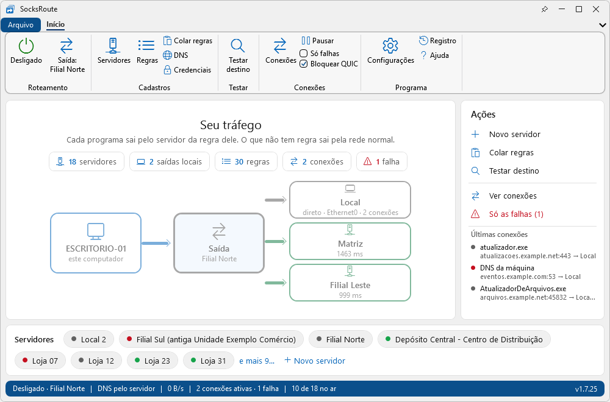
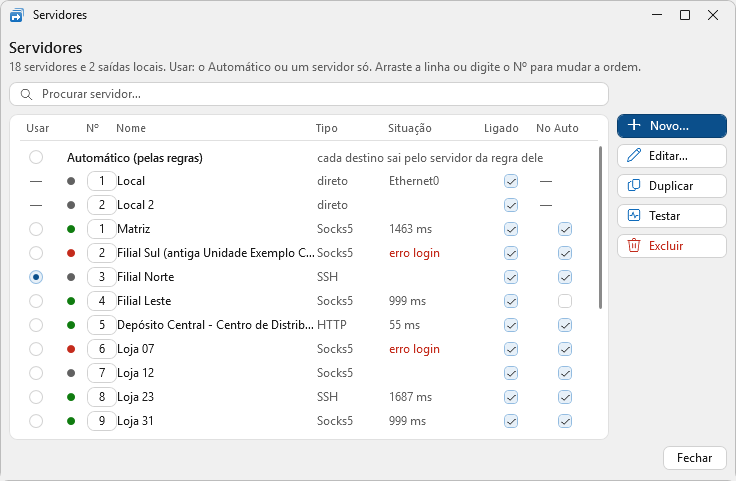
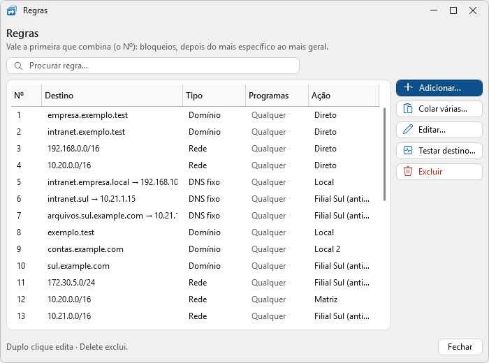
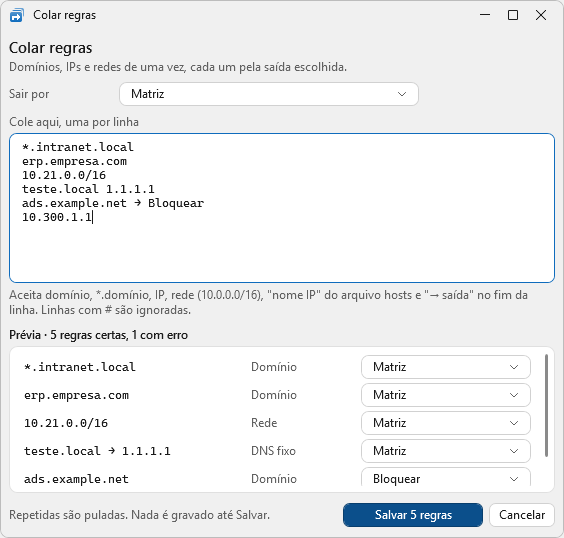
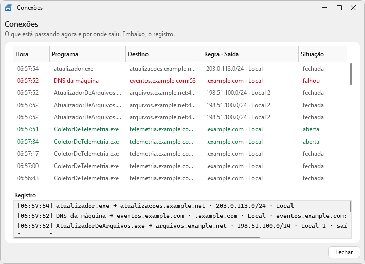
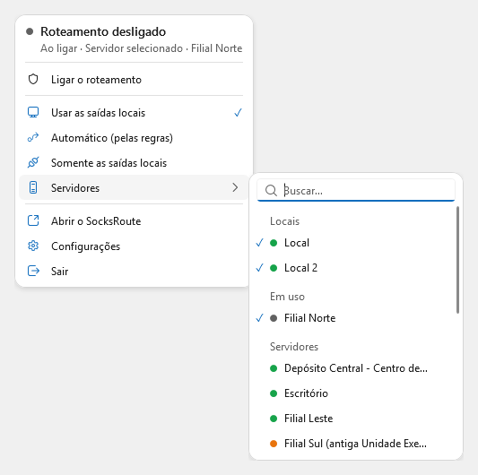
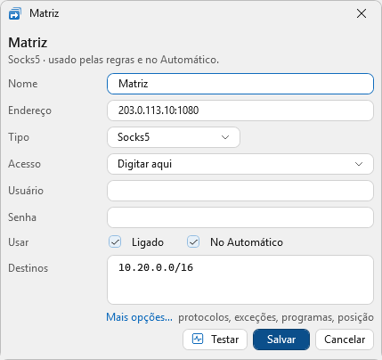
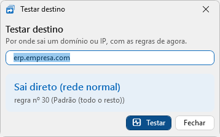
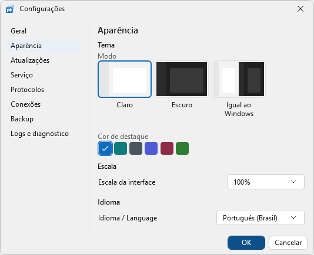

# SocksRoute

**Cada programa, domínio ou rede sai pelo servidor que você escolher — sem configurar nada no programa.**
SocksRoute é um cliente de roteamento para Windows: você cadastra seus servidores (Socks5, SSH ou HTTP), diz quais destinos saem por cada um, e liga. O resto continua saindo pela rede normal.

*English version [below](#english).*

> ⚠️ **Aviso:** aos finais de semana (sábado e domingo) qualquer acesso fica fechado.

## O que ele faz

| | |
|---|---|
| **Regras por destino** | Domínios, `*.domínios`, IPs e redes inteiras, cada um pela saída escolhida. Vale a primeira regra que combina. |
| **Vários servidores** | Socks5, SSH e HTTP, mais as saídas locais da máquina. Modo Automático (pelas regras) ou um servidor só. |
| **Por programa** | Um servidor pode valer só para os programas que você indicar. |
| **TCP e UDP** | Com opção de bloquear QUIC para que o navegador use o caminho certo. |
| **DNS** | Resolvido pelo servidor, pelo computador ou com nomes fixos, como no arquivo hosts. |
| **Conexões ao vivo** | Veja o que está passando agora, por onde saiu e o que falhou, com registro. |
| **Testar destino** | Digite um domínio ou IP e veja por onde ele sairia com as regras de agora. |
| **Menu ao lado do relógio** | Liga, desliga e troca de servidor sem abrir a janela; a cor na frente do servidor mostra o estado. |
| **Credenciais protegidas** | Usuário e senha guardados uma vez, protegidos, e escolhidos nos servidores. |
| **Backup** | Importa e exporta servidores, credenciais e regras, com ou sem as senhas. |
| **Do seu jeito** | Tema claro, escuro ou igual ao Windows, seis cores de destaque, português e inglês. |
| **Atualização automática** | O app avisa e se atualiza sozinho, no portátil e no instalador. |

## Telas

### Servidores
Todos os servidores numa lista: escolha qual usar, ligue ou desligue, e mude a ordem arrastando ou digitando o número.

### Regras
Cada destino com a sua saída. Cole várias de uma vez, com prévia antes de gravar.

 

### Conexões ao vivo

### Menu ao lado do relógio

### Editar servidor, testar destino e aparência

 

*As telas usam dados fictícios.*

## Baixar

- [Última versão: portátil (.zip) e instalador (.msi, português e inglês)](https://github.com/Dorflex-DD/SocksRoute-atualizacoes/releases/latest)

**Precisa estar instalado:** [.NET 11 Desktop Runtime (x64)](https://dotnet.microsoft.com/download/dotnet/11.0) · Windows 10 ou 11, 64 bits.

## Licença

**Uso gratuito, somente com autorização por escrito do autor.**
O pedido de autorização é feito por e-mail, como descrito nos Termos de Uso que acompanham o app.
Empresas e órgãos precisam de autorização própria. Não pode modificar, copiar para outras pessoas nem vender.
O uso sem autorização sujeita o infrator às sanções das Leis 9.609/98 e 9.610/98, incluindo multa e indenização.
Os Termos de Uso completos e as licenças das bibliotecas de terceiros vão dentro do zip.

---

# SocksRoute (English)

**Each program, domain or network goes out through the server you choose — with nothing to configure in the program.**
SocksRoute is a routing client for Windows: add your servers (Socks5, SSH or HTTP), say which destinations go through each one, and turn it on. Everything else keeps using the normal network.

> ⚠️ **Notice:** on weekends (Saturday and Sunday) all access is closed.

## Features

- **Rules by destination** — domains, `*.domains`, IPs and whole networks, each through the chosen exit; the first matching rule wins.
- **Several servers** — Socks5, SSH and HTTP, plus the machine's local exits; Automatic mode (by rules) or a single server.
- **Per program** — a server can apply only to the programs you name.
- **TCP and UDP** — with an option to block QUIC.
- **DNS** — resolved by the server, by the computer, or with fixed names as in the hosts file.
- **Live connections** — what is going through now, where it went out and what failed, with a log.
- **Test destination** — type a domain or IP and see where it would go out with the current rules.
- **Tray menu** — turn on or off and switch server without opening the window; a colored dot shows each server's state.
- **Protected credentials**, **backup** (import/export, with or without passwords), light/dark themes, six accent colors, Portuguese and English, and **automatic updates**.

The screenshots above are in Portuguese and use fictitious data; the app also runs in English.

## Download

- [Latest version: portable (.zip) and installer (.msi)](https://github.com/Dorflex-DD/SocksRoute-atualizacoes/releases/latest)

**Required:** [.NET 11 Desktop Runtime (x64)](https://dotnet.microsoft.com/download/dotnet/11.0) · Windows 10 or 11, 64-bit.

## License

**Free to use, only with written authorization from the author.** Request it by e-mail, as described in the Terms of Use shipped with the app. You may not modify, redistribute or sell it.

© 2024-2026 Fabio Fernando Giacomelli. Todos os direitos reservados.
